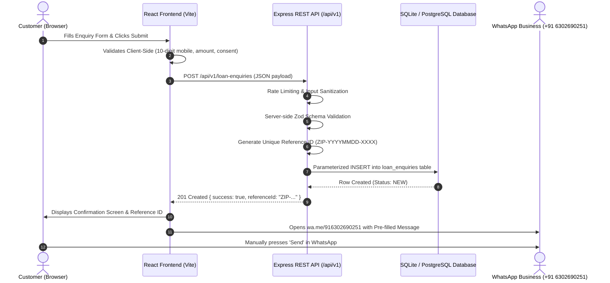

# Zippy ICICI Loan Connector – Backend REST API Documentation

**Version:** 1.0.0  
**Base URL:** `http://localhost:5000` (Local) / `/api/v1` (Production)  
**Protocol:** REST over HTTPS / HTTP  
**Content-Type:** `application/json`  
**Official WhatsApp Business Number:** `+91 63026 90251`  
**Official Business Email:** `zippyloanconnector2@gmail.com`  

---

## Architecture Overview

The Zippy ICICI Loan Connector Backend REST API is built with Node.js, Express, TypeScript, and SQLite (with PostgreSQL migration support). It provides high-performance, secure loan enquiry registration with automated reference ID generation, server-side validation, rate limiting, and privacy-conscious logging.



---

## 1. System Endpoints

### 1.1 Health Check

Returns the operational status of the API server, database connectivity, and uptime.

- **Method:** `GET`
- **Path:** `/api/v1/health`
- **Rate Limit:** 100 requests per 5 minutes

#### Sample Response (`200 OK`)
```json
{
  "status": "healthy",
  "service": "Zippy Loan Connector REST API",
  "version": "1.0.0",
  "timestamp": "2026-11-07T00:51:21.551Z",
  "uptimeSeconds": 45,
  "database": {
    "client": "sqlite",
    "status": "connected",
    "enquiryRecordsCount": 14
  },
  "businessContacts": {
    "phone": "+916302690251",
    "whatsapp": "916302690251",
    "email": "zippyloanconnector2@gmail.com"
  }
}
```

---

## 2. Loan Enquiry Endpoints

### 2.1 Submit Loan Enquiry

Accepts a customer's loan requirement, validates inputs, generates a unique reference ID, and persists the record into the database.

- **Method:** `POST`
- **Path:** `/api/v1/loan-enquiries`
- **Rate Limit:** 30 requests per 15 minutes per IP
- **Headers:** `Content-Type: application/json`

#### Request Body Schema

| Field | Type | Required | Constraints / Validation | Example |
|---|---|---|---|---|
| `fullName` | String | **Yes** | Min 3, Max 100 chars. Letters & spaces | `"Ramesh Reddy"` |
| `mobileNumber` | String | **Yes** | 10 digits starting with `6, 7, 8, 9` | `"9848012345"` |
| `email` | String | No | Valid email format, max 150 chars | `"ramesh@example.com"` |
| `city` | String | **Yes** | Selected city/district (min 2 chars) | `"Hyderabad"` |
| `loanCategory` | String | **Yes** | Valid loan product category | `"Personal Loans"` |
| `requiredAmount` | Number/String | **Yes** | Numeric value >= ₹10,000 | `1500000` |
| `employmentType` | String | **Yes** | `Salaried`, `Self-Employed`, etc. | `"Salaried"` |
| `monthlyIncome` | Number/String | No | Optional positive numeric value | `75000` |
| `additionalInfo` | String | No | Optional notes (max 1000 chars) | `"Lowest interest personal loan"` |
| `consent` | Boolean | **Yes** | Must be explicitly `true` | `true` |
| `sourceContext` | String | No | Context of submission | `"Website Loan Enquiry Form"` |

#### Sample Request Payload
```json
{
  "fullName": "Ramesh Reddy",
  "mobileNumber": "9848012345",
  "email": "ramesh.reddy@example.com",
  "city": "Hyderabad",
  "loanCategory": "Personal Loans",
  "requiredAmount": 1500000,
  "employmentType": "Salaried",
  "monthlyIncome": 75000,
  "additionalInfo": "Looking for quick processing and competitive interest rates.",
  "consent": true,
  "sourceContext": "Home Page Loan Enquiry Form"
}
```

#### Sample Response (`201 Created`)
```json
{
  "success": true,
  "referenceId": "ZIP-20261107-5829",
  "message": "Loan enquiry registered successfully. Our Hyderabad team will review and connect you with authorized lending channels.",
  "data": {
    "referenceId": "ZIP-20261107-5829",
    "fullName": "Ramesh Reddy",
    "loanCategory": "Personal Loans",
    "requiredAmount": 1500000,
    "status": "NEW",
    "createdAt": "2026-11-07T00:51:21.583Z"
  }
}
```

#### Error Response: Validation Error (`400 Bad Request`)
```json
{
  "success": false,
  "error": "VALIDATION_ERROR",
  "message": "Invalid loan enquiry details. Please review and correct the errors.",
  "details": {
    "mobileNumber": "Enter a valid 10-digit Indian mobile number starting with 6, 7, 8, or 9",
    "requiredAmount": "Minimum loan requirement is ₹10,000"
  }
}
```

#### Error Response: Rate Limit Exceeded (`429 Too Many Requests`)
```json
{
  "success": false,
  "error": "TOO_MANY_REQUESTS",
  "message": "Too many loan enquiries submitted from this network. Please wait 15 minutes or contact us directly on WhatsApp (+91 63026 90251)."
}
```

---

### 2.2 Check Enquiry Status by Reference ID

Allows safe querying of an existing enquiry status using only the reference ID. Does NOT expose customer mobile, email, or financial figures publicly.

- **Method:** `GET`
- **Path:** `/api/v1/loan-enquiries/:refId`
- **Example:** `/api/v1/loan-enquiries/ZIP-20261107-5829`

#### Sample Response (`200 OK`)
```json
{
  "success": true,
  "data": {
    "referenceId": "ZIP-20261107-5829",
    "loanCategory": "Personal Loans",
    "city": "Hyderabad",
    "status": "NEW",
    "createdAt": "2026-11-07T00:51:21.583Z"
  }
}
```

---

## 3. Database Schema

The database table `loan_enquiries` stores all submitted requests with complete auditability:

```sql
CREATE TABLE loan_enquiries (
  id INTEGER PRIMARY KEY AUTOINCREMENT,
  reference_id VARCHAR(50) NOT NULL UNIQUE,
  full_name VARCHAR(150) NOT NULL,
  mobile_number VARCHAR(15) NOT NULL,
  email VARCHAR(150) NULL,
  city VARCHAR(100) NOT NULL,
  loan_category VARCHAR(100) NOT NULL,
  required_amount NUMERIC NOT NULL,
  employment_type VARCHAR(100) NOT NULL,
  monthly_income NUMERIC NULL,
  additional_info TEXT NULL,
  source_context VARCHAR(100) DEFAULT 'Website Loan Enquiry Form',
  status VARCHAR(30) DEFAULT 'NEW',
  consent_given BOOLEAN NOT NULL DEFAULT 1,
  consent_timestamp TIMESTAMP NOT NULL DEFAULT CURRENT_TIMESTAMP,
  ip_address VARCHAR(45) NULL,
  user_agent TEXT NULL,
  created_at TIMESTAMP NOT NULL DEFAULT CURRENT_TIMESTAMP,
  updated_at TIMESTAMP NOT NULL DEFAULT CURRENT_TIMESTAMP
);
```

### Status Lifecycle
- `NEW`: Newly submitted enquiry, awaiting initial review.
- `IN_REVIEW`: Assigned to loan referral specialist.
- `CONTACTED`: Customer contacted via Call/WhatsApp.
- `REFERRED`: Application referred to authorized lender channel.
- `CLOSED`: Referral completed or customer opted out.

---

## 4. WhatsApp Click-to-Chat Integration

Following the backend submission, the frontend generates an official WhatsApp click-to-chat URL:

```
https://wa.me/916302690251?text=<URL_ENCODED_MESSAGE>
```

### Message Format:
```text
*New Loan Enquiry - Zippy Loan Connector*
Ref ID: *ZIP-20261107-5829*

*Customer Details:*
• Name: Ramesh Reddy
• Mobile: +91 9848012345
• Email: ramesh@example.com
• City: Hyderabad

*Loan Requirement:*
• Loan Type: *Personal Loans*
• Requested Amount: *₹15,00,000*
• Employment: Salaried
• Monthly Income: ₹75,000
• Notes: Looking for low interest rates

Hello Zippy Loan Connector Advisor, I have submitted my enquiry and would like guidance on suitable lender options.
```

The customer's browser opens this link in a new tab, where the customer manually taps **Send**.

---

## 5. Security & Privacy Guarantees

1. **Zero Sensitive Data:** This public API **never** accepts or stores Aadhaar numbers, PAN card numbers, bank account numbers, passwords, PINs, or document uploads.
2. **PII Masking:** Server logs automatically mask mobile numbers (e.g. `98****2345`) and emails (e.g. `r***@example.com`).
3. **SQL Injection Defense:** All database queries utilize parameterized bindings.
4. **Brute Force & DoS Protection:** Express rate limiting (30 requests/15 mins) and body size caps (50 KB).
5. **No Fake Claims:** Independent referral entity notice and disclaimers are preserved.

---

## 6. Testing with cURL

### Test Health Check:
```bash
curl -X GET http://localhost:5000/api/v1/health
```

### Test Enquiry Submission:
```bash
curl -X POST http://localhost:5000/api/v1/loan-enquiries \
  -H "Content-Type: application/json" \
  -d '{
    "fullName": "Suresh Kumar",
    "mobileNumber": "9876543210",
    "email": "suresh@example.com",
    "city": "Hyderabad",
    "loanCategory": "Home Loans",
    "requiredAmount": 4500000,
    "employmentType": "Salaried",
    "consent": true
  }'
```
